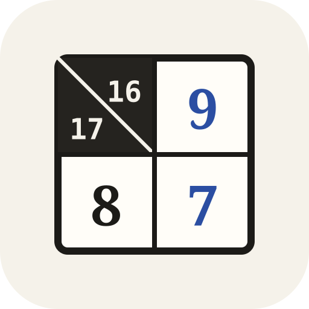

<div align="center">
  
  <h1>Kakuro Revisited</h1>
  <p><strong>A modern TypeScript Kakuro (Cross Sums) generator, human-style logical solver, trainer &amp; symbolic AI Coach.</strong></p>

  <p>
    <a href="https://kakurorevisited.com/"><strong>Website</strong></a> ·
    <a href="https://kakurorevisited.com/play/"><strong>Open Solver</strong></a> ·
    <a href="https://kakurorevisited.com/play/?daily=1"><strong>Daily Puzzle</strong></a> ·
    <a href="https://kakurorevisited.com/combinations/"><strong>Sum Combinations Cheat Sheet</strong></a> ·
    <a href="https://kakurorevisited.com/techniques/"><strong>Technique Guides</strong></a> ·
    <a href="https://kakurorevisited.com/manual/"><strong>Manual</strong></a>
  </p>

  <p>
    <a href="https://kakurorevisited.com/"></a>
    
    <a href="LICENSE"></a>
  </p>
</div>

---

## Overview

**Kakuro Revisited** is a deterministic TypeScript Kakuro (*Cross Sums*) puzzle generator, human-step logical solver, difficulty rater, and trainer inspired by classic open-source Java Kakuro tools (`crozzsum`, `kakurohelper`, `jkakuro`) and built as a sister project to [Hodoku Revisited](https://hodokurevisited.com/).

It pairs a pure TypeScript engine (`@kakuro/core`) with a fast, offline-capable Progressive Web App (`@kakuro/app`), an interactive **AI Coach & Contradiction Prover**, a live **Sum Combination Helper**, and a complete static reference website (`@kakuro/website`) featuring an interactive **Kakuro Sum Combinations Cheat Sheet**.

---

## Highlights

### 1. 100% Symbolic AI Super Solver & Coach
Built directly on top of the solver's bitmask and sum-partition engine in [`aiCoach.ts`](packages/app/src/aiCoach.ts):
- **4-Stage Socratic Walkthroughs (*Coach me*):** Step through any Kakuro deduction in four progressive stages on the board:
  1. **Where to look** — highlights the horizontal or vertical run (and its clue sum) to scan without giving away the answer.
  2. **The pattern** — names the technique and highlights the key cells and valid sum partitions.
  3. **The logic** — explains why the sum constraint and distinct-digit rule force the placement or elimination.
  4. **Conclusion** — reveals the final placement or struck-through candidate eliminations.
- **“Why not?” Contradiction Prover:** Select any white cell on the board and click **`Why not D?`** for any candidate. The solver places that digit, propagates forced run completions and intersections step by step, and highlights the exact run or cell where a sum overflow, sum underflow, duplicate digit, or starved cell occurs.
- **Interactive Sum Combination Helper:** Select any cell on the board to see the active Across and Down clue sums, remaining empty cells, residual sum needed, and every valid digit partition that fits the current board candidates.

### 2. Human-Style Logical Solving Techniques
`@kakuro/core` solves and rates Kakuro puzzles using human deduction steps ordered from simplest to most advanced:
1. **Last Cell in Run (`FULL_RUN`)** — A horizontal or vertical run has only one empty cell left; its digit is the clue sum minus the placed digits.
2. **Naked Single (`NAKED_SINGLE`)** — Only one candidate digit `1–9` remains in a cell.
3. **Unique Sum Partition / Magic Block (`MAGIC_BLOCK`)** — A run whose sum and length have only one possible set of digits (e.g., `4 in 2 = {1,3}`, `16 in 2 = {7,9}`, `17 in 2 = {8,9}`, `6 in 3 = {1,2,3}`, `24 in 3 = {7,8,9}`), restricting every cell in the run to those digits.
4. **Cross-Run Intersection (`CROSS_INTERSECTION`)** — At the intersection of an Across run and a Down run, any candidate that cannot participate in valid partitions of *both* runs is eliminated (often leaving a single digit at the crossing of two Magic Blocks).
5. **Minimum / Maximum Sum Bounds (`SUM_BOUNDS`)** — Eliminates candidates in a cell that would make the remaining cells in its run exceed the clue sum or fall short even with the largest/smallest available distinct digits.
6. **Mandatory Digit in Run (`MANDATORY_DIGIT`)** — When a digit appears in *every* remaining valid combination for a run (such as `1` and `2` in `7 in 3 = {1,2,4}` or `8 in 3 = {1,2,5}`) and only one cell in that run can accept it, that cell must take that digit.
7. **Hidden Single in Run (`HIDDEN_SINGLE_RUN`)** — A required digit for the only remaining partition of a run fits in just one cell of that run.
8. **Naked Pair / Triple in Run (`NAKED_PAIR`, `NAKED_TRIPLE`)** — Two or three cells in the same run hold only the same two or three candidates, locking those digits out of the rest of the run.
9. **Hidden Pair in Run (`HIDDEN_PAIR`)** — Two mandatory digits of a run are restricted to the same two cells, eliminating other candidates from those two cells.
10. **Locked Sum Residual (`LOCKED_SUM_RESIDUAL`)** — Uses the difference between total Across clues and Down clues in an overlapping sector (or locked pair sum inside a run) to deduce forced residual sums and placements.

---

## Architecture

```text
packages/
  core/      Pure TypeScript Kakuro engine (zero DOM/Node APIs, sum partition bitmasks, solver, generator)
  app/       Installable React + Vite PWA; solver and generator run in a cancellable Web Worker
  website/   Dependency-free static site generator: technique guides, sum combinations cheat sheet, learn pages & manual
```

---

## Development

Requires **Node.js 22+** and **pnpm 10+**.

```sh
pnpm install
pnpm typecheck
pnpm test
pnpm --filter @kakuro/app dev
pnpm --filter @kakuro/app build
pnpm --filter @kakuro/website build
pnpm --filter @kakuro/website test
```

## License

Free software under the **GNU General Public License v3.0 or later** (`GPL-3.0-or-later`). See [LICENSE](LICENSE).
